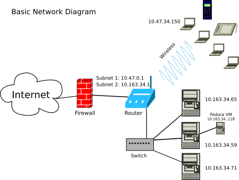

# Networking

By the end of this section, you should know:

1. The role of a system administrator in setting up, configuring, and monitoring networks, from small LANs to larger networks that interface with external networks.
2. The structure and layers of the Internet Protocol Suite, including the Link, Internet, Transport, and Application layers.
3. How the Address Resolution Protocol (ARP) is used to map IP addresses to MAC addresses, and how to view network information using commands like `ip a` and `ip link`.
4. The distinction between public and private IP addresses, the ranges for private IPs, and the concept of IP subnets.
5. How the Transmission Control Protocol (TCP) and User Datagram Protocol (UDP) differ in handling data, including typical use cases for each.
6. The basics of TCP and UDP headers, and how to examine network traffic using `tcpdump`.
7. The significance of ports in networking, common port numbers, and how ports help direct traffic to specific services.
8. The concept of subnetting, including how subnet masks and CIDR notation help define network boundaries and control the number of hosts on a network.
9. How to convert between binary and decimal for IP addressing, as well as the importance of subnet masks and broadcast addresses.
10. The process of calculating available hosts in a subnet, including examples for both /24 and /16 subnet masks.

## Getting Started

An important function of a system administrator is to set up, configure, and monitor a network.
This may involve planning, configuring, and connecting the devices on a local area network, to planning and implementing a large network that interfaces with an outside network,
and to monitoring networks for various sorts of attacks, such as [denial of service attacks][DOS].

In order to prepare for this type of work, we need at least a basic understanding of how the internet works and how local devices interact with the internet.
In this section, we will focus mostly on internet addressing, but we will also devote some space to TCP and UDP, two protocols for transmitting data.

Network communication commonly uses protocols from the [Internet protocol suite][wikiIPS], including TCP/IP and UDP/IP.
Like the [OSI communication model][osi], this suite describes network communication in layers, although the two models organize those layers differently.

The internet protocol suite is framed as a series of layers beginning with a lower layer, called the **link layer**,
that interfaces with internet capable hardware, to the highest layer, called the **application layer**, e.g., the web (`http`).

The **link layer** describes the local area network.
Devices connected locally, e.g., via Ethernet cables or local wifi, comprise the link layer.
The link layer connects to the **internet layer**.
Data going into or out of a local network must be negotiated between these two layers.

The **internet layer** makes the internet possible since it provides functionality to transmit data among multiple networks possible.
The internet is, in fact, a network of networks.
The primary characteristic of the internet layer is the **IP address**, which currently comes in two versions: IPv4 (a 32 bit number) and IPv6 (a 128 bit number).
IP addresses are used to locate hosts on a network.

The **transport layer** makes the exchange of data on the internet possible.
There are multiple protocols for the transport layer, but the two main ones are [UDP][udp] and [TCP][tcp].
Very generally, [UDP][udpCloudFlare] allows applications to send data without establishing a connection or waiting for retransmission of lost data.
For example, Voice-over-IP (VOIP), online gaming, and some streaming applications use UDP because timely delivery can matter more than recovering every missing piece of data.
[TCP][tcpCloudFlare] provides reliable, ordered delivery by detecting errors and retransmitting lost data.
If delivery fails, the connection can terminate.
Applications can also implement reliable delivery over UDP, as QUIC does.

The **application layer** provides the ability to use the internet in particular ways.
For example, the [HTTP][http] protocol enables the **web**.
The **web** can be thought of as an **application** of the internet.
Likewise, the **SMTP**, **IMAP**, and **POP** protocols provide the basis for email exchange, **DNS** maps IP addresses to domain names, and we use **SSH** to connect to our virtual machines.

> By **application**, we simply mean that these protocols provide the functionality for applications.
> They are not themselves considered user applications, like a web browser.

## The Internet Protocol Suite

### Link Layer

#### ARP (Address Resolution Protocol)

**ARP** (Address Resolution Protocol) is a protocol at the link layer and is used to map network addresses, like an IP address, to ethernet addresses.
An ethernet address is more commonly referred to as the MAC or Media Access Control address, or the hardware address.
Hosts and routers use ARP on IPv4 Ethernet networks to discover the MAC address associated with a local next-hop IP address.
This allows them to address Ethernet frames to another host on the local network or to a router for delivery beyond that network.
Your internet capable devices, such as smartphones and laptops, generally have a MAC address for each Ethernet or wifi interface.

To get the MAC address for a specific computer, we can use the following commands:

```
ip a
```

Or:

```
ip link
```

> In the above command, `ip` is the command and `a` or `link` are considered objects (see `man ip` for details).
> Note that `ip a` and `ip link` provide slightly different views of network interfaces.

The MAC addresses are reported on the **link/ether** line.

On my virtual server, the `ip link` command produces **numbered** sections of output.
The first section refers to the `lo` or loopback device.
This is a special device that allows the computer to communicate with itself; Linux displays its link address as 00:00:00:00:00:00, but it is not an Ethernet interface.
The next two sections on the machine refer to the ethernet cards (e.g., `eth0` and `eth1`).
These represent the hardware for system's wired connections to the internet.
On this virtual machine, `eth0` provides the connection to the outside world, and `eth1` provides the connection to the private subnet.
These roles depend on the machine's configuration, not on the interface names.
The MAC addresses are reported on the indented lines below.
See `man systemd.net-naming-scheme` for more details.

We can get the IP information with the following command:

```
ip a
```

The `ip a` command reports both the MAC and IP addresses for the same devices.
Here it reports that the `lo` device has the IP address of 127.0.0.1.
This is the conventional IPv4 loopback address.
On my virtual machine, I get an IP address like `10.116.0.2/20` for the `eth1` device.
This is a **private IP address**, which can be used within a private network, including across its routed subnets, but is not globally routable on the public internet.

The following two commands help identify parts of the local network (or subnet) and the routing table.

```
ip neigh
ip route
```

The `ip neigh` command displays the neighbor table, including cached IPv4 ARP entries and IPv6 neighbor entries.
These entries identify neighbors on local links that the machine has learned about; they are not a complete inventory of the network.
The router may appear here after the machine has communicated through it.

The `ip route` command displays the IPv4 routing table by default and can also be used to modify routes.
Both commands are useful on ordinary Linux hosts as well as Linux-based routers.

These details enable the following scenario:
A router can be configured with an IP address and subnet prefix for its local network.
If it also runs a DHCP server, it can assign addresses from a configured pool to clients that request them.
The DHCP server identifies clients using a client identifier or their MAC address.
On a typical home network, the assigned addresses are private IP addresses within one of the ranges discussed below.

### Internet Layer

#### IP (Internet Protocol)

The Internet Protocol provides addressing and delivery of packets between hosts across interconnected networks.
IP addresses are assigned to network interfaces, and subnet prefixes identify their network portions.
Subnets can use either public or private IP addresses.

Remember this: public IP addresses are distinct from private IP addresses.
Public IP addresses can be globally routed on the internet, although access to a particular host may be restricted.
Private IP addresses are used within private networks and are not globally routable on the public internet.

Private IP address ranges are **reserved** address ranges.
These ranges are reserved for private networks rather than globally routable public addressing.
The private address ranges include:

| Start Address | End Address     | Network Size |
|---------------|-----------------|--------------|
| 10.0.0.0      | 10.255.255.255  | Large        |
| 172.16.0.0    | 172.31.255.255  | Medium       |
| 192.168.0.0   | 192.168.255.255 | Small        |

If you have a router at home and examine the IPv4 address of a connected phone or computer, you will typically see an address within one of the ranges above.
For example, it might have an IP address like **192.168.0.4**.
This is a common IP address number assigned by a home router.

These private address blocks differ in the total number of addresses they contain.
The **10.X.X.X** block contains more addresses than the **172.16.0.0–172.31.255.255** block, which contains more than the **192.168.X.X** block.
The larger block is useful for organizations that need many subnets.
However, the number of addresses in an individual subnet depends on its prefix length, as discussed below.

#### Example Private IP Usage

Let's say my campus desktop's IP address is **10.163.34.59/24** via a wired connection.
And my office neighbor has an IP address of **10.163.34.65/24** via their wired connection.
Both IP addresses are private because they fall within the **10.0.0.0 to 10.255.255.255** range.
And it's likely they both exist on the same subnet since they share the first three **octets**: **10.163.34.XX**.

However, if we both, using our respective wired connected computers, searched Google for *what's my IP address*,
suppose we see that we share the same public IP address, which is **128.163.8.25**.
This is a public IPv4 address, although being outside the private ranges alone is not sufficient to establish that an address is public.
The result shows that these web requests appear to originate from the same public IP address, consistent with a shared network address translation (NAT) gateway.
Replies to those requests are translated and forwarded to the respective computers; this does not mean unsolicited incoming traffic can reach them.

Let's say I switch my computer's network connection to the campus's wifi network.
When I check with `ip a`, I find that the computer now has a private IP address of **10.47.34.150/16**.
You can see the pattern is different with this IP address than it was when it was connected via wire.
The reason it has a different pattern is because the laptop is now on an different subnet.
This wireless subnet was configured to allow more hosts to connect to it since it must allow for more devices (i.e., laptops, phones, etc).
When I searched Google for my IP address from this laptop, it reports **128.163.238.148**.
This indicates that the wired and wireless requests use different public source addresses; it does not by itself establish who owns those addresses.

Here's a visual diagram of what this network looks like:

<figure>

<figcaption>
Fig. 1. This figure contains a Layer 2 network switch, which forwards Ethernet frames within the local network.
The switch uses destination MAC addresses rather than destination IP addresses to make these forwarding decisions.
The router acts as the interface between the private network and the public network and
is managing two subnets: a wired and a wireless one.
</figcaption>
</figure>

#### Using the `ip` Command

The `ip` command can do more than provide us information about our network.
We can also use it to turn a connection to the network on or off (and more).
The commands below show how we disable and then enable a connection on a machine.
Note that **ens4** is the name of my network card/device.
We probably have the same device names, but note that it might be different.

```
sudo ip link set ens4 down
sudo ip link set ens4 up
```

> Don't run these commands on the interface used for your remote connection: disabling it will drop that connection, and you may need to use the web console to re-enable it.

### Transport Layer

The internet (IP) layer carries packets containing application data encapsulated by transport protocols.
The transport layer provides communication between application endpoints, with different delivery features depending on the protocol.
As discussed previously, the two most common transport layer protocols are **TCP** and **UDP**, but [there are more][TLP_wiki].

#### TCP, Transmission Control Protocol

*TCP* or Transmission Control Protocol is responsible for the transmission of data and for making sure the data arrives at its destination w/o errors.
If there are errors, the data is re-transmitted or halted in case of failure.
Much of the data sent over the internet is sent using TCP.

#### UDP, User Datagram Protocol

The **UDP** or User Datagram Protocol sends datagrams without guaranteeing delivery or ordering and without retransmitting lost data.
It includes a checksum for detecting corruption, although this checksum can be omitted in IPv4.
UDP is useful for voice over internet calls and streaming applications.
QUIC runs over UDP and adds features including reliable streams and built-in encryption.
 
#### TCP and UDP Headers

TCP sends **segments**, while UDP sends **datagrams**; **packet** is also used as a general term.
Both protocols include headers with source and destination ports and other transport information.
Their data is carried inside IP packets, whose headers provide the addresses used for routing.

We can see this header data using the `tcpdump` command, which requires `sudo` or being **root** to use.
The IP header includes source and destination addresses along with other fields.
In IPv4, these addresses follow fields including the version, header length, total length, fragmentation information, time to live, protocol, and header checksum.

If you want to use `tcpdump`, **you should use it on your local computer and not on your virtual machine**.
I'm not sure how the hosting provider will respond to this kind of activity because it might be deemed malicious.
But to use it, first we identify the IP number of a host, which we can do with the `ping` command, and then run `tcpdump`:

```
ping -c1 www.uky.edu
sudo tcpdump host 128.163.35.46
```

While that's running, we can type that IP address in our web browser, or enter **www.uky.edu**, and watch the output of `tcpdump`.

TCP headers include port information and other mandatory fields for both source and destination servers.
The SYN, or synchronize, message is sent when a source or client requests a connection.
The ACK, or acknowledgment, message is sent in response, along with a SYN message, to acknowledge the request for a connection.
Then the client responds with an additional ACK message.
This is referred to as the [TCP three-way handshake][tcphandshake].
In addition to their headers, TCP segments and UDP datagrams can carry application data, and both protocols provide checksum-based error detection.

#### Ports

TCP and UDP use port numbers to distinguish communication endpoints used by applications on a host.
Ports are part of the **transport layer** of the internet suite.
Together, IP addresses, transport protocols, and port numbers help direct traffic to the appropriate service.
For example, port 80 is the default port for unencrypted HTTP traffic.
Thus, traffic sent to **10.0.5.33:80** would conventionally be intended for an HTTP service, although the port number alone does not establish which protocol the traffic contains.
Note that the port info is attached to the end of the IP address via a colon. 

Other common ports include:

- 21: FTP
- 22: SSH
- 25: SMTP
- 53: DNS
- 143: IMAP
- 443: HTTPS
- 587: Email submission, commonly secured using STARTTLS
- 993: IMAP Secure

A list of the default ports/protocols on your Linux systems is contained in the following file:

```
less /etc/services
```

See also the Wikipedia page: [List of TCP and UDP port numbers][portnumbers]

## IP Subnetting

Let's now return to the internet layer and discuss one of the major duties of a systems administrator: subnetting.

Subnets are used to carve out smaller and more manageable subnetworks out of a larger network.
Subnetting divides an IP address block into smaller networks by assigning longer network prefixes.
Routers, including Layer 3 switches, can route traffic between these subnets.

### Private IP Ranges

For the following subnetting examples, we will work with the private IPv4 ranges:

| Start Address | End Address     |
|---------------|-----------------|
| 10.0.0.0      | 10.255.255.255  |
| 172.16.0.0    | 172.31.255.255  |
| 192.168.0.0   | 192.168.255.255 |

It's important to be able to work with IP addresses like those listed above in order to subnet; and therefore, we will need to learn a bit of IP math along the way.

#### IP Meaning

An IPv4 address is 32 bits (8 x 4), or four bytes, in size.
In human readable context, it's usually expressed in the following, decimal-based, notation style:

- **192.168.1.6**
- **172.16.3.44**

Each set of numbers separated by a dot is referred to as an **octet**.
An **octet** is a group of 8 **bits**.
Eight **bits** equals a single **byte**.
By implication, 8 gigabits equals 1 gigabyte, and 8 megabits equals 1 megabyte.
We use these symbols to note the terms:

| Term  | Symbol |
|-------|--------|
| bit   | *b*    |
| byte  | B      |
| octet | *o*    |

Each bit is represented by either a 1 or a 0.
For example, the first address above in binary is:

- **11000000.10101000.00000001.00000110** is **192.168.1.6**

Or:

| Byte     | Decimal Value |
|----------|---------------|
| 11000000 | 192           |
| 10101000 | 168           |
| 00000001 | 1             |
| 00000110 | 6             |

### IP Math

When doing IP math, one easy way to do it is to simply remember that each bit in each of the above bytes is a placeholder for the following values:

```
128 64 32 16 8 4 2 1
```

Alternatively, from low to high:

| base-2        | Output |
|---------------|--------|
| 2<sup>0</sup> | 1      |
| 2<sup>1</sup> | 2      |
| 2<sup>2</sup> | 4      |
| 2<sup>3</sup> | 8      |
| 2<sup>4</sup> | 16     |
| 2<sup>5</sup> | 32     |
| 2<sup>6</sup> | 64     |
| 2<sup>7</sup> | 128    |

It's helpful to work backward.
For IP addresses, all octets are 255 or less (256 total, from 0 to 255) and therefore do not exceed 8 bits or places.
To convert the integer 192 to binary:

```
1 * 2^7 = 128
1 * 2^6 =  64 (128 + 64 = 192)
```

Then STOP.
There are no values left, and so the rest are zeroes.
Thus: 11000000

Our everyday counting system is base-10, but binary is base-2, and thus another way to convert binary to decimal is to multiple each bit (1 or 0) by the power of base two of its placeholder:

```
(0 * 2^0) = 0 +
(0 * 2^1) = 0 +
(0 * 2^2) = 0 +
(0 * 2^3) = 0 +
(0 * 2^4) = 0 +
(0 * 2^5) = 0 +
(1 * 2^6) = 64 +
(1 * 2^7) = 128 = 192
```

Another way to convert to binary: simply subtract the numbers from each value.
As long as there is something remaining or the placeholder equals the remainder of the previous subtraction, then the bit equals 1.
So:

- 192 - 128 = 64 -- therefore the first bit is equal to 1.
- Now take the leftover and subtract it:
- 64 - 64 = 0 -- therefore the second bit is equal to 1.

Since there is nothing remaining, the rest of the bits equal 0.

### Subnetting Examples

Subnetting involves dividing a network into two or more subnets.
When we subnet, we first identify the number of hosts (i.e., the size of the subnet) we will require on the subnet.
For starters, let's assume that we need a subnet that can assign at most 254 IP addresses to the devices attached to it via the router.

To describe the subnet, we need its **network address/ID** and **subnet mask**.
The **network address** identifies the network, and the **subnet mask** marks the boundary between the network and host portions of an address.
Knowing the subnet mask allows us to determine the subnet's address capacity.
The mask is written in dotted-decimal notation, but it is a bitmask rather than an address assigned to a device.

From the network address and subnet mask, we can determine the **broadcast address**.
For the subnets in these examples, the network address and broadcast address cannot be assigned to ordinary hosts.
The broadcast address is the last address in the subnet and allows a host or router to address all hosts on that subnet.

For our sake, let's work through this process backwards;
that is, let's identify and describe a network that we are already connected to and for which we already know a device's private IP address.
We'll work with example private IP addresses that exist on separate subnets.

#### Example IP Address 1: 192.168.1.6/24

Using the private IP address **192.168.1.6** and the supplied **/24** prefix, let's derive the subnet mask and network address (or ID).
First, convert the decimal notation to binary.
State the mask, which is **/24**, or **255.255.255.0**.
And then derive the network addressing using an **bitwise logical AND** operation:

```
11000000.10101000.00000001.00000110 IP              192.168.1.6
11111111.11111111.11111111.00000000 Mask            255.255.255.0
-----------------------------------
11000000.10101000.00000001.00000000 Network Address 192.168.1.0
```

Note the mask has 24 ones followed by 8 zeroes.
The /24 is used as [CIDR][cidr] notation and marks the network portion of the IP address.
The remaining 8 bits are for the host addresses.

- 192.168.1.6/24

For Example 1, we thus have the following subnet information:

| Type         | IP            |
|--------------|---------------|
| Netmask/Mask | 255.255.255.0 |
| Network ID   | 192.168.1.0   |
| Start Range  | 192.168.1.1   |
| End Range    | 192.168.1.254 |
| Broadcast    | 192.168.1.255 |

#### Example IP Address 2: 10.160.38.75/24

For example 2, let's start off with a private IP address of 10.160.38.75 and a mask of /24:

```
00001010.10100000.00100110.01001011 IP               10.160.38.75
11111111.11111111.11111111.00000000 Mask            255.255.255.0
-----------------------------------
00001010.10100000.00100110.00000000 Network Address   10.160.38.0
```

| Type         | IP            |
|--------------|---------------|
| Netmask/Mask | 255.255.255.0 |
| Network ID   | 10.160.38.0   |
| Start Range  | 10.160.38.1   |
| End Range    | 10.160.38.254 |
| Broadcast    | 10.160.38.255 |

#### Example IP Address 3: 172.16.1.62/24

For example 3, let's start off with a private IP address of 172.16.1.62 and a mask of /24:

```
10101100 00010000 00000001 00111110 IP                172.16.1.62
11111111 11111111 11111111 00000000 Mask            255.255.255.0
-----------------------------------
10101100 00010000 00000001 00000000 Network Address    172.16.1.0
```

| Type         | IP            |
|--------------|---------------|
| Netmask/Mask | 255.255.255.0 |
| Network ID   | 172.16.1.0    |
| Start Range  | 172.16.1.1    |
| End Range    | 172.16.1.254  |
| Broadcast    | 172.16.1.255  |

#### Determine the Number of Hosts

To determine the number of hosts on a CIDR /24 subnet, we look at the start and end ranges.
In all three of the above examples, the start range begins with X.X.X.1 and ends with X.X.X.254.
Therefore, there are 254 maximum hosts allowed on these subnets because 1 to 254, inclusive of 1 and 254, is 254.

#### Example IP Address 4: 10.0.5.23/16

The first three examples show instances where the CIDR is set to /24.
This only allows 254 maximum hosts on a subnet.
If the CIDR is set to /16, then we can theoretically allow 65,534 hosts on a subnet. 

For example 4, let's start off then with a private IP address of 10.0.5.23 and a mask of /16:

```
00001010.00000000.00000101.00010111 IP Address: 10.0.5.23
11111111.11111111.00000000.00000000 Mask:       255.255.0.0
-----------------------------------------------------------
00001010.00000000.00000000.00000000 Network ID: 10.0.0.0
```

| Type         | IP            |
|--------------|---------------|
| IP Address   | 10.0.5.23     |
| Netmask/Mask | 255.255.0.0   |
| Network ID   | 10.0.0.0      |
| Start Range  | 10.0.0.1      |
| End Range    | 10.0.255.254  |
| Broadcast    | 10.0.255.255  |

The last two octets contain the 16 host bits.
Each octet has 256 possible values, from 0 through 255, giving 256 × 256 total addresses.

- Number of Hosts = 256 x 256 = 65536
- Subtract Network ID (1) and Broadcast (1) = 2 IP addresses
- Number of Usable Hosts = 256 x 256 - 2 = 65534

### IPv6 subnetting

We're not going to cover IPv6 subnetting, but if you're interested, this is a nice article: [IPv6 subnetting overview][ipv6subnetting]

## Conclusion

As a systems administrator, it's important to have a basic understanding of how networking works, and the basic models used to describe the internet and its applications.
System administrators have to know how to create subnets and defend against various network-based attacks.

In order to acquire a basic understanding, this section covered topics that included:

- the internet protocol suite
  - link layer
  - internet layer
  - transport layer
- IP subnetting
  - private IP ranges
  - IP math

In the next section, we extend upon this and discuss the domain name system (DNS) and domain names.

[wikiIPS]:https://en.wikipedia.org/wiki/Internet_protocol_suite
[osi]:https://en.wikipedia.org/wiki/OSI_model
[udp]:https://en.wikipedia.org/wiki/User_Datagram_Protocol
[tcp]:https://en.wikipedia.org/wiki/Transmission_Control_Protocol
[http]:https://en.wikipedia.org/wiki/Hypertext_Transfer_Protocol
[DOS]:https://en.wikipedia.org/wiki/Denial-of-service_attack
[udpCloudFlare]:https://www.cloudflare.com/learning/ddos/glossary/user-datagram-protocol-udp/
[tcpCloudFlare]:https://www.cloudflare.com/learning/ddos/glossary/tcp-ip/
[headers]:https://www.cloudflare.com/learning/network-layer/what-is-a-packet/
[tcpfields]:https://www.imperva.com/learn/ddos/tcp-transmission-control-protocol/
[udpfields]:https://www.imperva.com/learn/ddos/udp-user-datagram-protocol/
[tcphandshake]:https://www.geeksforgeeks.org/tcp-3-way-handshake-process/
[portnumbers]:https://en.wikipedia.org/wiki/List_of_TCP_and_UDP_port_numbers
[cidr]:https://en.wikipedia.org/wiki/Classless_Inter-Domain_Routing
[ipv6subnetting]:https://supportforums.cisco.com/document/66991/ipv6-subnetting-overview-and-case-study
[TLP_wiki]:https://en.wikipedia.org/wiki/Category:Transport_layer_protocols
